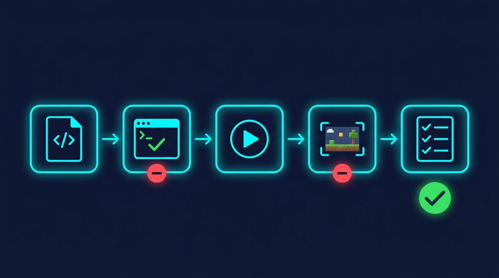

# QA gates — the checklists that stop "done but broken"



Two kinds of gates:

- **Per-change gate** — must pass before the agent says "done" about anything.
- **Release gate** — must pass before you publish an update.

Print the checklist, make the agent paste the results. Unchecked = unfinished.

---

## 1. Per-change gate (copy into every milestone prompt)

```
CHANGE GATE — answer every line with evidence, not a sentence.

STRUCTURE
[ ] execute_luau (Edit) printed every instance path I claim to have created
[ ] inspect_instance on one key instance: Anchored, Size, Position correct
[ ] no duplicate instances (search_game_tree count matches the spec)

CODE
[ ] script_read the edited range back — the file matches what I intended
[ ] --!strict on new modules; no `wait()`, no deprecated API
[ ] no stray print/debug leftovers (script_grep "print(")

RUNTIME
[ ] get_console_output: ZERO errors, ZERO warnings (paste the output)
[ ] the real player action was performed with character_navigation / user_*_input
[ ] execute_luau (Server) printed before/after values that match the spec
[ ] the numbers are within 5% of GDD.01_Mechanics (state the delta)

VISUAL
[ ] screen_capture taken and described with 3 concrete facts
[ ] nothing floating, intersecting, z-fighting, or unlit
[ ] readable at 360×640 (mobile) if there is any UI on screen

SAFETY
[ ] every new remote validates type + range + ownership + rate limit
[ ] any money/progress/fairness value is computed server-side
[ ] DataStore changes: pcall + retry + session lock still intact

TESTS
[ ] Tests/Suites case(s) added for the new logic
[ ] the literal "SUMMARY x/y" line where x == y

HYGIENE
[ ] save_place called
[ ] GDD.JOURNAL entry appended (what changed, what's verified, next step)
[ ] Progress.<Milestone> flipped only if all of the above is true
```

---

## 2. Release gate (before you press Publish)

### 2.1 Technical
| Check | Pass condition | How |
|---|---|---|
| Console clean | zero errors in a 15 min session | `get_console_output` after a real playtest |
| Server heartbeat | < 5 ms at target players | MicroProfiler / sampler |
| Client frame | ≥ 45 fps mid-range Android | device emulation or a real phone |
| Data survival | join → play → leave → rejoin → identical | manual, 5 cycles |
| Server shutdown | `BindToClose` saves | Studio stop during a session, then rejoin |
| Exploit pass | fake times/positions/purchases rejected | run the exploit scripts in the game's own tests |
| Mobile UI | playable one-handed at 360×640 | `screen_capture` at that size |
| Streaming | enabled, stages/plots `Atomic` | properties |
| No free-model junk | every inserted asset inspected | `search_game_tree` + spot checks |
| Asset ids centralized | no inline `rbxassetid://` outside `Assets.lua` | `script_grep "rbxassetid"` |

### 2.2 Game feel (measure, don't vibe)
| Metric | Target (genre-specific) | Where |
|---|---|---|
| Time to first meaningful action | < 30 s | stopwatch a brand-new tester |
| First 5 minutes contain a win | yes | watch one person, don't help them |
| Death/retry cost (obby) | ≤ 1.5 s | measure |
| Time to afford next purchase (tycoon) | ≤ 90 s, always | instrument in code |
| First mutation/harvest (garden) | < 3 min | stopwatch |
| Round length (prop hunt) | 3–4 min | `execute_luau` log |
| Chase frequency (horror) | 1 per 3–5 min | bot run logs |
| Any moment of confusion | 0 major | 3 testers, note every "what do I do?" |

### 2.3 Content completeness (count it, don't trust it)
```lua
-- execute_luau (Edit) — run this before every release
local checks = {
	{ path = "Workspace.Stages", expect = 48, label = "stages" },
	{ path = "ReplicatedStorage.Assets.Props", expect = 60, label = "props" },
	{ path = "ReplicatedStorage.GDD.01_Mechanics", expect = 1, label = "mechanics module" },
}
for _, c in checks do
	local node = game:GetService("ReplicatedStorage")
	for part in string.gmatch(c.path, "[^%.]+") do
		node = node and node:FindFirstChild(part)
	end
	local count = node and #node:GetChildren() or 0
	print(`{c.label}: {count} (expected {c.expect}) -> {count == c.expect and "OK" or "MISMATCH"}`)
end
```

### 2.4 Store page
- [ ] Icon 512×512, readable at 150×150 (squint test)
- [ ] 3 thumbnails 1280×720 that show the **mechanic**, not a logo
- [ ] Description: first line states the hook; second line how to play
- [ ] Genre/tags set; max players set; private servers configured if sold
- [ ] Badge/leaderboard stats wired
- [ ] Monetization: every product/gamepass exists, priced, `ProcessReceipt` idempotent
- [ ] Odds disclosed for any paid random item

---

## 3. Exploit test suite (write these as game tests)

Run these as part of `Tests/Suites`. If a test can't "exploit" the game, that's a pass.

| Test | Attempt | Pass condition |
|---|---|---|
| `exploit.fast_finish` | fire `StageFinished` at 0.4 s | server rejects, logs |
| `exploit.teleport_purchase` | `RequestPurchase` from 500 studs away | rejected |
| `exploit.free_cash` | set client-side cash attribute | server value unchanged |
| `exploit.double_buy` | 100 rapid purchases | exactly one succeeds |
| `exploit.harvest_unripe` | harvest at 10% growth | rejected |
| `exploit.reroll` | rejoin mid-growth 5× | mutation identical every time |
| `exploit.tag_through_wall` | 200 tag events without LOS | zero land |
| `exploit.equip_unowned` | equip a cosmetic not owned | rejected |
| `exploit.shard_steal` | two clients claim the same pickup | exactly one |
| `exploit.rate_flood` | 1000 remote calls in 1 s | throttled, server stays < 5 ms |

```lua
{ suite = "exploit", case = "fast_finish_rejected",
  run = function()
    local player = game.Players:GetPlayers()[1]
    local Progress = require(game.ServerScriptService.Services.ProgressService)
    Progress.beginRun(player, "1-1")
    local ok = Progress.finishRun(player, "1-1")   -- called immediately
    return ok == false, "instant finish rejected"
  end }
```

---

## 4. Soak and stress

| Test | How | Pass |
|---|---|---|
| 20-player soak, 20 min | bots via subagent playtest | heartbeat < 5 ms, zero errors, no memory climb |
| 50 rounds prop hunt | bot round loop | no stuck phase, no leaked Highlights |
| 200 harvests garden | simulator | odds match spec, no timer drift |
| 30 min tycoon idle | leave a client | income exactly matches `rate × time` ±1% |
| 10 joins/leaves rapidly | script | no data loss, no duplicate plots |
| Server shutdown mid-save | stop Studio during a purchase | no corruption on rejoin |

Memory detail: check workspace child count and `Instance` count before/after a 20-minute run.
A climbing count means something is created and never destroyed — the classic leak from
spawning a `Highlight`, `Sound`, or `BillboardGui` per event.

---

## 5. Playtest protocol (3 testers, 20 minutes, no help)

1. Give them **no instructions**. Start the stopwatch.
2. Record: time to first action, first win, first confusion, first death, first purchase.
3. Note every question they ask. Each question is a UI bug, not a player failure.
4. Watch for "dead time" — any stretch > 20 s with nothing to do.
5. After: ask exactly three questions.
   - "What do you do in this game?" (if they can't say it in one sentence, the hook is unclear)
   - "What did you want to do but couldn't?"
   - "Would you play again tomorrow? Why?"
6. Fix the top 3 issues before the next milestone. Log them in `JOURNAL`.

**Minimum for first publish:** 3 testers, 1 of them on a phone, 1 who has never played a
game like it.

---

## 6. Definition of Done (put this in the GDD)

```
A task is DONE when all six are true:
1. Structurally exists (execute_luau asserted the instance tree)
2. Runs clean (zero console errors during the real action)
3. Numbers match the spec (±5%, stated)
4. Looks right (screen_capture + 3 visible facts)
5. Can't be exploited (the relevant exploit test fails to exploit)
6. Survives a rejoin (state persists, nothing duplicated)
Otherwise the status is "written, unverified" — and reported as such.
```

---

## 7. Red flags, ranked by how much they cost you

| # | Red flag | Why it's expensive | Fix now |
|---|---|---|---|
| 1 | Data can be wiped | Destroys reviews permanently | Session lock + migration + BindToClose |
| 2 | Client-trusted money/progress | Economy dead on day 2 | Server authority + exploit suite |
| 3 | Memory leak (instances per event) | Server dies at 20 players | Destroy/reuse; soak test |
| 4 | Unplayable on mobile | Lose ~half the audience | 360×640 test, thumb-zone UI |
| 5 | First 30 s unclear | Lose the click-through you paid for | Watch 3 testers, fix the spawn |
| 6 | Per-object loops | Server lag at scale | One loop + timestamps |
| 7 | Silent pcall | Bugs become data loss | Log everything, remove blanket pcall |
| 8 | "About N" content | Ships incomplete | Count with execute_luau |
| 9 | No exploit tests | One player ruins the leaderboard | Add the suite |
| 10 | Odds not disclosed | Policy risk + trust collapse | Publish odds matching code |
